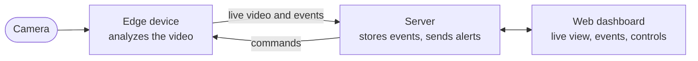

# Smart Surveillance System

A smart surveillance system that combines on-device video analysis with a web dashboard. An edge device next to the camera analyzes the video in real time, using image processing and deep learning for motion detection, human detection and face recognition. It sends the live video and detected events to a server, where the dashboard lets you watch the camera, review events and control the system from the browser.

## Features

- **Live view:** watch the camera in the browser, with detections marked on the video in real time.
- **Motion detection:** notices movement in the scene using image processing.
- **Human detection:** finds people with a deep-learning model, so shadows, pets or swaying trees don't raise alarms.
- **Face recognition:** tells known people apart from strangers.
- **Real-time alerts:** notifies you as soon as something is detected.
- **Event history:** saves detections as events you can review later.
- **Remote control:** configure and control the edge device from the dashboard.
- **Encrypted streams:** video is encrypted at the application layer, before it travels over the network.

## How it works

- **Edge device:** captures the video and analyzes it on the device itself, then sends the live video and events to the server. Because the analysis happens next to the camera, the server doesn't have to analyze any video.
- **Server:** receives the video and events, keeps the event history, sends alerts and hosts the web dashboard.
- **Web dashboard:** shows the live video with detections, lists past events and sends your commands to the edge device through the server.

## Hardware

The edge software is designed to run on any computer that has Python and a camera. Detection speed depends on the device's processing power. The reference setup for this project is a **Raspberry Pi 5** with a **USB camera**.
